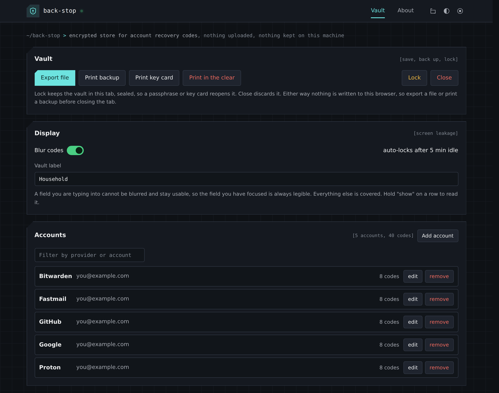

# back-stop

A private, offline store for account recovery codes: the one-time codes a
service gives you to get back in when your authenticator is gone. It holds
them encrypted, and gives you three ways to keep a copy that survive losing
your devices - an encrypted file, an encrypted printed backup, and a plaintext
sheet for a safe.



Download `index.html` and open it in a browser. There is nothing to install,
and it makes no network connections. It can also read a printed backup itself,
without a phone scanner app; see
[Scanning without a phone scanner app](#scanning-without-a-phone-scanner-app).

## Getting started

1. Open `index.html` and choose **New vault**. Use a passphrase of six or more
   unrelated words: length is what protects the vault.
2. **Add account** for each service, and paste in its recovery codes.
3. Keep a copy before you close the tab - nothing is saved in the browser.
   **Export file**, **Print backup**, or both.
4. **Print key card** and store it somewhere apart from everything else. It is
   your way back in if you forget the passphrase.

Next time, open the vault **From a file** or **From paper** and unlock it with
your passphrase or the key card.

## What it does

- Keeps a vault of accounts behind a passphrase, each with its recovery codes.
- Exports an encrypted `.json` file. Open it again later, add more, export again.
- Prints an encrypted QR backup for somewhere less trusted than a safe.
- Prints every code in plain text, three dense columns to a sheet, for a safe.
- Prints a key card that opens the vault without the passphrase.
- Restores from the exported file or the printed QR codes.
- Reads the printed QR codes itself, through the camera or from photos, with a
  decoder of its own, so no phone scanner app is needed (From paper, then Scan
  with the camera).
- Keeps free-text notes per account, and one for the vault as a whole, for
  anything that is not a list of codes.
- Keeps accounts in alphabetical order by provider.

## Keeping your copies safe

| | What you need to open it | Where it belongs |
|---|---|---|
| Exported file | this tool + passphrase or key card | disk, sync, wherever |
| Printed backup | a phone camera, or back-stop's own scanning, + passphrase or key card | a folder, a deposit box, a relative's house |
| Plaintext sheet | nothing | a safe |
| Key card | - | apart from all of the above |

The plaintext sheet is the strongest last resort precisely because it depends
on nothing: no passphrase, no scanner, no working copy of this tool. It is also
the one that is equivalent to the codes themselves, so it needs physical
protection rather than encryption. Keep it apart from the printed backup and
the key card.

**The key card opens the vault on its own.** That is what makes it a way back
in, and it is also why it must never be stored with the exported file or the
printed backup: together they give anyone full access.

### Paper only is a complete workflow

Nothing requires you to keep a `.json` file. Print a backup and a key card,
store them apart, and that is a whole strategy. **From paper** takes the
scanned text back in, and either the passphrase or the key card opens it.

To restore from paper, scan each QR code with your phone's camera app and paste
the text into **From paper**, in any order. That is easiest done entirely on a
phone. If you would rather not use a scanner app at all, **From paper** can do
the scanning inside back-stop.

### Backups on several sheets

A large vault prints across more than one sheet - roughly fifty to eighty
codes fit on one, fewer for long random codes and more for short numeric
ones - and **every sheet is required**. Losing one sheet loses the whole
vault, not part of it.

That makes the usual advice, to keep copies in different places, actively
wrong for the sheets of a single backup: splitting three sheets across three
places turns one point of failure into three. Keep the sheets together, and for
a copy somewhere else, print a second complete set. Each sheet carries a
reminder of this.

Every sheet of one print carries the same **set mark**: three coloured squares
and a six-character code. It is worked out from the backup itself, so a second
export, which holds different ciphertext, gets a different mark. If two prints
ever end up in the same pile, the marks tell you which sheets go together. The
code is there as text because a black-and-white printer drops the colours. The
last page of every backup explains, for someone who has never seen back-stop,
how to open it with nothing but Python.

## Scanning without a phone scanner app

A phone's camera app or a scanner app is someone else's software looking at your
backup. The codes are encrypted and no use without your passphrase or key card,
but if you would rather not hand them to an app you cannot read, back-stop does
the reading itself.

It is part of opening a vault. Choose **From paper**, then **Scan with the
camera**, or **Add photos** if you would rather use pictures. The decoder is
written for this tool and sits in `index.html`. Hold the sheets up one at a time,
in any order, and each is ticked off. When the last one is in, the backup opens
and asks for your passphrase, or for the key card: **Scan key card** reads its
square code and unlocks straight away. The key card can also be scanned first,
or along with the sheets, and it unlocks the backup the moment there is one. A
vault file you open with **From a file** can be unlocked the same way.

- **No clipboard.** The backup goes from the scanner to where you unlock, inside
  the page, and a scanned key goes through the same check as a typed one without
  ever being put in the key box, so neither can be left in clipboard history or
  read off the screen. The scanner has no copy buttons.
- **Mirror.** Some webcams and front cameras give a mirror image. The decoder
  reads those as they are, and flips the picture so a sheet looks right; the
  **Mirror** button flips it back.
- **The camera.** Only while you press Scan with the camera or Scan key card. It
  turns off when every sheet is in, when the key card is read, when you press
  Stop, and when you leave the tab.
- **Nothing leaves it.** What it reads is kept in memory only, cleared by Start
  over, after five minutes idle, and once the vault is open.
- **Getting a good read.** Even light, no glare, the sheet flat and the square
  filling most of the view. A dense sheet, with many small squares, needs a
  steadier hand and a sharper camera than a small one: move closer, use Zoom if
  it appears, or add a photo instead.
- **If it will not read a code,** any other scanner will, and you can paste what
  it gives you into the box under the camera buttons. `recover.py` opens a
  scanned backup with nothing but Python, and **Save as text file** writes the
  joined backup for it.

## If you forget your passphrase

Open the vault with the key card, then choose **Change passphrase** and set a
new one. Export or print again so your copies use it.

If a key card is lost, or someone else has seen it, choose **Change
passphrase** and tick **Also replace the key**. That gives the vault a new key,
so every card printed before stops working. Print a new key card and a new
backup straight afterwards.

Neither can reach copies you made earlier. A file exported before the change
still opens with the old passphrase, and a backup printed before it still opens
with the old passphrase or the old card. If those are the reason you are
changing it, destroy them.

## Lock and close

**Lock** hides the vault but keeps it in the tab, so your passphrase or key card
reopens it without re-opening a file or re-scanning paper. The vault also locks
itself after five minutes idle.

**Close** discards it. Nothing is ever written to the browser, so export or
print before you close the tab.

## Opening a vault without this tool

`recover.py`, in this repository, opens an exported file or a scanned backup
and prints the codes, using nothing but Python. It is for the day this page is
not available - a backup you can only read with the tool that wrote it is a
bet that the tool still works in whatever browser you have in ten years.

    python3 recover.py vault.json            # passphrase, prompted
    python3 recover.py scanned.txt           # text scanned off the printed backup
    python3 recover.py vault.json --key      # use the key card instead
    python3 recover.py vault.json --json     # raw JSON rather than a listing
    pbpaste | python3 recover.py             # straight from a scan

It needs Python 3.6 or newer and nothing else: no `pip`, no internet. The
machine where you need it may be offline, locked down or borrowed, so it
deliberately depends on nothing. It works out which kind of input it has been
given, accepts the key card with the same tolerance for case and spacing as the
tool, and lists accounts in the same order.

It only reads. It never changes, re-encrypts or writes a vault, and it prints
to the screen rather than saving a file. If you redirect that output to a file,
remember the file is now your codes in plain text.

**Check your copy before you rely on it:**

    python3 recover.py --selftest

This runs published test vectors for the encryption, plus checks of the key
card format. Every check should pass. If any fail, that copy is damaged or has
been altered, so do not use it.

## What else it holds

Recovery codes are the first use, not the only one. Anything that is a small
text secret you need to survive losing your devices fits, which is what the
notes are for:

- **Break-glass credentials.** Emergency local administrator and root
  passwords, firewall enable secrets, out-of-band and IPMI logins, emergency
  access accounts. Classic sealed-envelope material, usually kept in a
  spreadsheet nobody trusts.
- **Disk encryption recovery keys.** BitLocker and FileVault. The key that
  unlocks a disk cannot usefully live on that disk.
- **Crypto seed phrases.** Short, catastrophic to lose, catastrophic to leak.
  The notes take the derivation path and wallet model alongside the words.
- **Offline root CA material.** Key ceremony data and root key passphrases.
- **Authenticator seeds, not just recovery codes.** The secret behind each
  authenticator entry, so a new phone can be set up again rather than using up
  a recovery code.
- **An estate file.** What an executor needs: which accounts exist, where the
  documents are, what to close. The plaintext sheet in a safe suits this,
  because nobody at that point will scan a QR code or know a passphrase.

### Where it is the wrong tool

- **A daily password manager.** No autofill, no browser integration, and a
  plaintext print button. The friction suits break-glass use and gets in the
  way of daily use.
- **Shared team secrets.** No multiple users, no access log, no record of who
  saw what.
- **Regulated or client data.** No audit trail, and a plaintext print option
  is a compliance problem waiting to happen.
- **Splitting the key between people.** back-stop has no M-of-N sharing: the
  key card is one string that opens the vault by itself. If you want it held
  by several people so that no one of them can open it, store the 54-character
  key in a tool built for that, such as
  [papervault](https://github.com/boazeb/papervault), which splits a small
  secret across printed keys. back-stop does not integrate with it and has not
  reviewed it.

## Privacy

- **Nothing leaves the page.** It cannot connect to the internet at all.
- **Nothing is saved in the browser.** Your codes and notes live in the tab's
  memory until you close it. The only thing stored is your choice of design,
  mode and accent.
- **Codes and notes are blurred on screen.** Hold **show** to read one. A field
  you are typing in stays readable, and everything re-blurs when you switch
  tabs or windows.
- **Only the three print buttons print anything.** Pressing Ctrl+P on its own
  prints a short notice and none of your data.
- **Printing in the clear asks first**, and says what the sheet means.
- **Spellcheck and autofill are off** in every field, since some browsers send
  what you type to a remote spellcheck service.
- **There are no copy buttons**, because clipboard history can sync between
  devices. The scanner hands the backup and the key to the unlock step directly
  for the same reason.
- **The camera is off until you switch it on**, and only Scan with the camera and
  Scan key card can.
- **Closing the tab with a vault open asks first.**

Print on paper with a local printer. Printing to PDF saves your codes to disk,
and network printers can keep a copy of the job, so check the print queue
afterwards.

## What it protects against, and what it does not

**It protects against:**

- **Losing every device.** The exported file, the printed backup and the
  plaintext sheet each survive on their own.
- **Someone getting one encrypted copy.** A stolen or leaked file or printed
  backup is useless without the passphrase or the key card.
- **The page reporting back.** It makes no network connections, and its
  content security policy forbids them.
- **Leaving traces in the browser.** Nothing is stored there but your choice
  of design, mode and accent.
- **A scanner app you do not trust.** back-stop can read the printed codes
  itself, in a page with no network access.
- **A damaged or altered copy.** Encryption is authenticated, so a corrupted
  file or backup fails to open rather than producing wrong codes.
- **The tool going away.** `recover.py` opens the file or the printed backup
  with nothing but Python.

**It does not protect against:**

- **Malware, or someone else controlling the computer, while a vault is
  open.** Keyloggers, screen capture, a hostile browser extension and a
  remote session can all read what you can read. Blurring and auto-lock are
  for people in the room, not for software on the machine.
- **Someone watching you type or read.** Blurred fields shrink the glance
  window; they do not remove it.
- **A tampered copy of the tool.** A modified `index.html` can do anything the
  real one can. The only defence is checking the copy you run; see
  [Checking your copy](#checking-your-copy).
- **Anyone holding the key card and a copy of the vault.** That is a complete
  set. Keep them apart.
- **The plaintext sheet falling into the wrong hands.** It is the codes
  themselves, with nothing between them and the reader.
- **A short or guessable passphrase, once someone has the file.** They can
  try guesses offline for as long as they like.
- **Memory that cannot be wiped.** Lock and Close drop the vault and zero the
  key bytes, but JavaScript cannot erase the strings your codes were held in,
  and the operating system may have written memory to a swap or hibernation
  file. Close the tab, and on a machine you do not trust, restart it.
- **The printed backup describing itself.** Each sheet shows, in the clear,
  that it is a back-stop backup, the vault label you gave it, the date, the
  size and the number of accounts. Leave the label vague if that matters.
- **Coercion and social engineering.** There is no duress passphrase and no
  hidden vault.
- **Losing everything.** Every copy gone, or one sheet of a multi-sheet
  backup, loses the vault.

## Known limits

- **Your passphrase is the main protection for an exported file.** The key
  derivation is the strongest the browser offers without extra software, but
  someone with the file and enough computing power can still break a short
  passphrase. Use six or more unrelated words.
- **The key card opens the vault on its own.** Store it apart from the file and
  the printed backup, or the encryption buys nothing.
- **Changing the passphrase or key cannot recall old copies.** Destroy files
  and printouts made before the change if they are the reason for it.
- **The key card's typo check is good, not perfect.** A rare slip gets past it
  and then fails with the general "does not open this vault" message. Check
  the characters against the card again.
- **`recover.py` does its own decryption** rather than using a library, so it
  can run with nothing installed. It passes the published test vectors and
  opens vaults made by the tool, which is evidence but not an independent
  audit. It is the fallback for when the browser is gone, not the everyday way
  in. The self-test runs on every push and before every release.
- **The QR codes are drawn by code in `index.html`** rather than by a library,
  for the same reason: nothing to install, and nothing to trust but the file.
  That makes the encoder the likeliest place for a quiet bug, and it has not
  been independently reviewed. `AI_AUDIT_INSTRUCTIONS.md` says how to check
  it with a separate decoder, and a printed backup should be test-restored
  from paper once before you rely on it.
- **The scanner's decoder is hand-written too**, and has not been
  independently reviewed. It accepts a code only when every block of error
  correction checks out, and what it hands over is ciphertext, so a misread
  fails to decrypt instead of producing wrong codes. It is a convenience: any
  other scanner reads the same codes.
- **The scanner shares a page with your codes.** It parses pixels from a camera
  or a photo in the same page that holds an unlocked vault. It never reads the
  vault, and the page cannot send anything anywhere, but it is code handling
  untrusted input next to your data, which a separate page would not be. The
  camera permission is likewise for the whole page, though the page only turns
  it on when you ask.
- **If you use a hosted copy, you are trusting whoever hosts it**, since they
  control the page that handles your codes. Compare its hash with the one on
  the release page before entering anything real, or just use the file
  directly.

## Checking your copy

Releases are on the
[Releases page](https://github.com/shanemc92/back-stop/releases). Each one has
`index.html`, `recover.py` and a `SHA256SUMS` file, and a signed attestation
tying the two files to this repository, the workflow that published them and
the commit the tag points at. There is no build step: the files are exactly
what is in the repository.

Put the downloaded files and `SHA256SUMS` in one folder, then check the
hashes. On Linux, or macOS with `shasum -a 256 -c` in place of `sha256sum -c`:

    sha256sum -c SHA256SUMS

On Windows, print each hash and compare it with `SHA256SUMS` by eye:

    Get-FileHash index.html, recover.py -Algorithm SHA256

Then check the attestation. It needs the [GitHub CLI](https://cli.github.com/),
and it proves the file came from this repository's release workflow, which a
matching hash alone does not:

    gh attestation verify index.html --repo shanemc92/back-stop
    gh attestation verify recover.py --repo shanemc92/back-stop

Do this on the copy you will actually use, and again for any copy somebody
else hosts. The tip of `main` is not a release and is not covered.

## Reviewing the code

`AI_AUDIT_INSTRUCTIONS.md` is a guide for reviewing the tool, by a person or
by an AI assistant: which claims in this README to check, where in the code to
check each one, and which parts are hand-written and so most worth a second
pair of eyes. Findings can go to the maintainer through GitHub's private
vulnerability reporting on this repository.

## Technical reference

For checking how the vault is protected, or for opening one without either
tool.

### Encryption

Envelope encryption. The vault body is AES-256-GCM under a random 256-bit data
key. That data key is wrapped with a second AES-256-GCM key derived from the
passphrase with PBKDF2-HMAC-SHA256, 600,000 iterations and a 16-byte random
salt. The passphrase is normalised to Unicode NFKC before derivation. The
additional authenticated data for both layers is the ASCII string
`back-stop-vault-1`, and each encryption uses a fresh random 12-byte nonce.

The data key stays the same across exports, so a key card keeps working as the
vault grows. **Change passphrase** re-wraps the same key under a new
passphrase, with a new salt; **Also replace the key** generates a new data key.

### Key card

The key card holds the 32-byte data key in Crockford base32: one case, and the
letters `I`, `L`, `O` and `U` never appear. On input `I` and `L` read as `1`
and `O` as `0`, and spaces, line breaks and case are ignored. The 52 characters
of key are followed by 2 check characters, the first two Crockford digits of
`SHA-256(key)`, so a single-character slip is reported as a typo. The card also
carries the same string as a QR code.

### Exported file

```json
{
  "app": "back-stop", "format": "back-stop-vault-1", "schema": 1,
  "kdf":  { "alg": "PBKDF2-SHA256", "iter": 600000, "salt": "base64" },
  "wrap": { "alg": "A256GCM", "iv": "base64", "ct": "base64" },
  "body": { "alg": "A256GCM", "comp": "gzip", "iv": "base64", "ct": "base64" }
}
```

### Printed backup

The QR codes carry this binary layout, base64 encoded and split across codes,
each prefixed `BS1:i/n:`. Join them in order of `i` before decoding. The layout
is also printed on the backup itself.

| Field | Bytes |
|---|---|
| magic `BS` | 2 |
| envelope version | 1 |
| PBKDF2 iterations / 1000, big endian | 2 |
| PBKDF2 salt | 16 |
| wrapped-key nonce | 12 |
| wrapped 32-byte data key + 16-byte tag | 48 |
| body nonce | 12 |
| flags, bit 0 set when the body is gzipped | 1 |
| body ciphertext + tag | rest |

## Files

    index.html                  the tool. One file, open it in a browser.
    recover.py                  opens a vault without the browser. Python standard library only.
    README.md                   this file.
    AI_AUDIT_INSTRUCTIONS.md    a guide for reviewing the code.
    LICENSE                     MIT.
    _headers                    security headers, if you host it on Netlify or similar.
    .htaccess                   the same for Apache.
    docs/                       the screenshot above.
    .github/workflows/          checks on every push, and the release workflow.

## Licence

MIT, Shane McElhinney.
